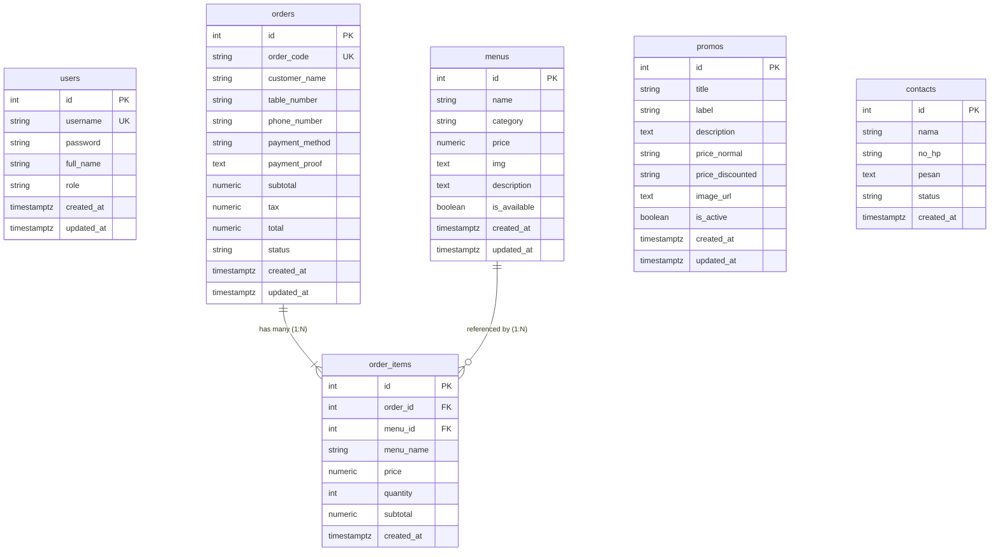

# ☕ Perancangan Database & Arsitektur ERD - Kopi Ruang Kita
**Role**: Orang 1 - Database Architect & Full DevOps Lead  
**Database Engine**: PostgreSQL 15+ (Host: Neon.tech / Supabase / Render PostgreSQL)  

---

## 1. Diagram Hubungan Entitas (Entity Relationship Diagram - ERD)

---

## 2. Spesifikasi Kamus Data (Data Dictionary)

### 2.1. Tabel `users`
Menyimpan akun kredensial manajemen toko (Owner, Administrator, dan Kasir/Staff).

| Kolom | Tipe Data | Nullable | Default | Keterangan & Batasan |
| :--- | :--- | :---: | :--- | :--- |
| `id` | `SERIAL` | NO | Auto Increment | **PRIMARY KEY** |
| `username` | `VARCHAR(50)` | NO | - | **UNIQUE**, identifier login |
| `password` | `VARCHAR(255)` | NO | - | Hash Bcrypt (cost factor 10) |
| `full_name` | `VARCHAR(100)` | NO | - | Nama lengkap staf/karyawan |
| `role` | `VARCHAR(20)` | NO | `'staff'` | `CHECK (role IN ('owner', 'admin', 'staff'))` |
| `created_at` | `TIMESTAMPTZ` | NO | `CURRENT_TIMESTAMP`| Waktu pembuatan user |
| `updated_at` | `TIMESTAMPTZ` | NO | `CURRENT_TIMESTAMP`| Auto update via trigger |

### 2.2. Tabel `menus`
Menyimpan seluruh katalog menu minuman kopi, non-coffee, serta snack.

| Kolom | Tipe Data | Nullable | Default | Keterangan & Batasan |
| :--- | :--- | :---: | :--- | :--- |
| `id` | `SERIAL` | NO | Auto Increment | **PRIMARY KEY** |
| `name` | `VARCHAR(120)` | NO | - | Nama item menu |
| `category` | `VARCHAR(50)` | NO | - | `CHECK (category IN ('Coffee', 'Non-Coffee', 'Snack', 'Food', 'Dessert'))` |
| `price` | `NUMERIC(12,2)`| NO | - | `CHECK (price >= 0)` |
| `img` | `TEXT` | YES | NULL | URL poster / gambar menu |
| `description`| `TEXT` | YES | NULL | Deskripsi rasa dan bahan menu |
| `is_available`| `BOOLEAN` | NO | `TRUE` | Status ketersediaan menu (ready/sold out) |
| `created_at` | `TIMESTAMPTZ` | NO | `CURRENT_TIMESTAMP`| Waktu input menu |
| `updated_at` | `TIMESTAMPTZ` | NO | `CURRENT_TIMESTAMP`| Auto update via trigger |

### 2.3. Tabel `orders`
Menyimpan catatan transaksi induk / pesanan meja pelanggan.

| Kolom | Tipe Data | Nullable | Default | Keterangan & Batasan |
| :--- | :--- | :---: | :--- | :--- |
| `id` | `SERIAL` | NO | Auto Increment | **PRIMARY KEY** |
| `order_code` | `VARCHAR(30)` | NO | - | **UNIQUE**, misal: `'KRK-837492'` |
| `customer_name`| `VARCHAR(100)`| NO | - | Nama pemesan |
| `table_number`| `VARCHAR(20)` | NO | - | Nomor meja pemesan |
| `phone_number`| `VARCHAR(30)` | NO | - | Nomor HP / WhatsApp pemesan |
| `payment_method`| `VARCHAR(20)`| NO | - | `CHECK (payment_method IN ('QRIS', 'TRANSFER', 'CASH'))` |
| `payment_proof` | `TEXT` | YES | NULL | Bukti transfer (Data URI Base64 atau URL) |
| `subtotal` | `NUMERIC(12,2)`| NO | - | `CHECK (subtotal >= 0)` |
| `tax` | `NUMERIC(12,2)`| NO | `0` | Pajak 10% `CHECK (tax >= 0)` |
| `total` | `NUMERIC(12,2)`| NO | - | Total bayar `CHECK (total >= 0)` |
| `status` | `VARCHAR(20)` | NO | `'PENDING'` | `CHECK (status IN ('PENDING', 'PAID', 'PROCESSING', 'COMPLETED', 'CANCELLED'))` |
| `created_at` | `TIMESTAMPTZ` | NO | `CURRENT_TIMESTAMP`| Tanggal pemesanan dibuat |
| `updated_at` | `TIMESTAMPTZ` | NO | `CURRENT_TIMESTAMP`| Auto update via trigger |

### 2.4. Tabel `order_items`
Menyimpan rincian setiap item menu yang dipesan pada satu transaksi `orders`.

| Kolom | Tipe Data | Nullable | Default | Keterangan & Batasan |
| :--- | :--- | :---: | :--- | :--- |
| `id` | `SERIAL` | NO | Auto Increment | **PRIMARY KEY** |
| `order_id` | `INTEGER` | NO | - | **FOREIGN KEY** `REFERENCES orders(id) ON DELETE CASCADE` |
| `menu_id` | `INTEGER` | YES | NULL | **FOREIGN KEY** `REFERENCES menus(id) ON DELETE SET NULL` |
| `menu_name` | `VARCHAR(120)` | NO | - | Snapshot nama menu saat transaksi |
| `price` | `NUMERIC(12,2)`| NO | - | Snapshot harga satuan saat transaksi |
| `quantity` | `INTEGER` | NO | - | `CHECK (quantity > 0)` |
| `subtotal` | `NUMERIC(12,2)`| NO | - | `CHECK (subtotal >= 0)` |
| `created_at` | `TIMESTAMPTZ` | NO | `CURRENT_TIMESTAMP`| Waktu item dimasukkan |

### 2.5. Tabel `promos`
Menyimpan penawaran menarik, diskon, dan bundling hemat.

| Kolom | Tipe Data | Nullable | Default | Keterangan & Batasan |
| :--- | :--- | :---: | :--- | :--- |
| `id` | `SERIAL` | NO | Auto Increment | **PRIMARY KEY** |
| `title` | `VARCHAR(120)` | NO | - | Judul penawaran promo |
| `label` | `VARCHAR(50)` | NO | - | Badge label (contoh: `'PAKET NYORE'`) |
| `description`| `TEXT` | YES | NULL | Rincian promo |
| `price_normal`| `VARCHAR(50)` | YES | NULL | Teks harga normal (contoh: `'Rp34.000'`) |
| `price_discounted`| `VARCHAR(50)`| YES | NULL | Teks harga diskon / jam promo |
| `image_url` | `TEXT` | YES | NULL | Path/URL banner promo |
| `is_active` | `BOOLEAN` | NO | `TRUE` | Status tayang promo |
| `created_at` | `TIMESTAMPTZ` | NO | `CURRENT_TIMESTAMP`| Waktu dibuat |
| `updated_at` | `TIMESTAMPTZ` | NO | `CURRENT_TIMESTAMP`| Auto update via trigger |

### 2.6. Tabel `contacts`
Menyimpan pesan masukan, pertanyaan, atau keluhan dari formulir kontak.

| Kolom | Tipe Data | Nullable | Default | Keterangan & Batasan |
| :--- | :--- | :---: | :--- | :--- |
| `id` | `SERIAL` | NO | Auto Increment | **PRIMARY KEY** |
| `nama` | `VARCHAR(100)` | NO | - | Nama lengkap pengirim pesan |
| `no_hp` | `VARCHAR(30)` | NO | - | Nomor kontak WhatsApp / Telepon |
| `pesan` | `TEXT` | NO | - | Isi pesan masukan atau pertanyaan |
| `status` | `VARCHAR(20)` | NO | `'UNREAD'` | `CHECK (status IN ('UNREAD', 'READ', 'ARCHIVED'))` |
| `created_at` | `TIMESTAMPTZ` | NO | `CURRENT_TIMESTAMP`| Waktu formulir disubmit |

---

## 3. Relasi dan Integritas Data

1. **Relasi `orders` ke `order_items` (1 : N)**:
   - Satu order dapat memiliki banyak order items.
   - Menggunakan `ON DELETE CASCADE`: Jika data pesanan dihapus, seluruh detail rincian itemnya otomatis terhapus demi menjaga kebersihan data.
2. **Relasi `menus` ke `order_items` (1 : N)**:
   - Menggunakan `ON DELETE SET NULL`: Jika sebuah menu dihapus dari katalog di kemudian hari, rekaman historis transaksi tetap aman (`menu_name` dan `price` sudah di-snapshot di `order_items`).
3. **Optimasi Performa dengan Index**:
   - `idx_orders_order_code`: Mempercepat lookup struk transaksi pelanggan berdasarkan kode unik (misal `KRK-123456`).
   - `idx_orders_status`: Mempercepat query penyaringan antrean kasir / dapur (misal pesanan `PENDING` / `PROCESSING`).
   - `idx_orders_created_at`: Mempercepat sorting laporan transaksi harian/bulanan.
   - `idx_menus_category` & `idx_menus_is_available`: Mempercepat filtering menu di aplikasi frontend.
